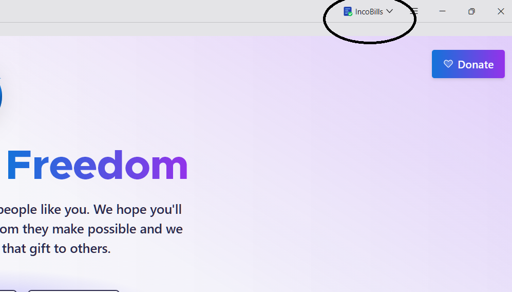
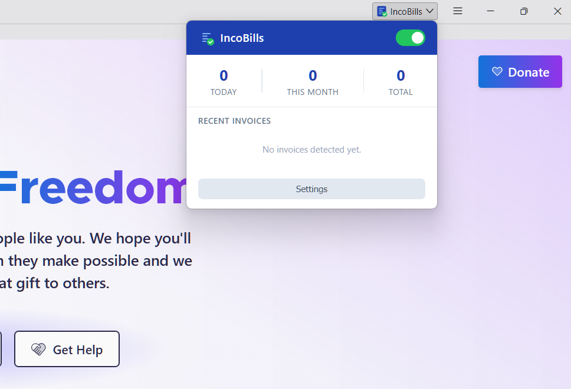
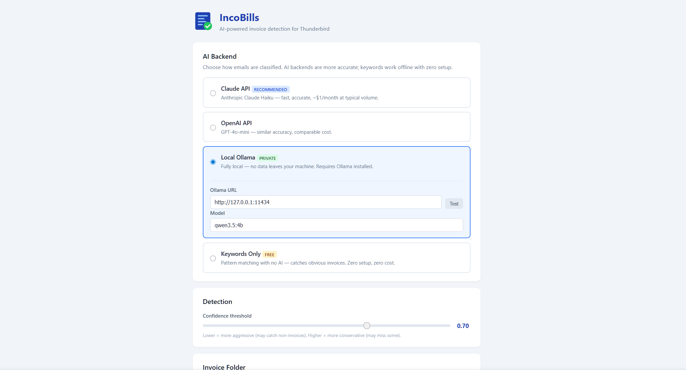

# IncoBills — AI-Powered Invoice Detection for Thunderbird

A Thunderbird MailExtension that classifies incoming email with AI (or local keyword heuristics), moves invoice emails into monthly folders, and — for Romanian companies — turns invoices into **SAGA** XML import files.

Built by [ServerSpan](https://www.serverspan.com/en/) — the hosting company where real sysadmins answer your tickets.

**[Install from Thunderbird Add-ons](https://addons.thunderbird.net/en-US/thunderbird/addon/incobills/)**

---

## Features

- **AI classification** — Claude, OpenAI (or any OpenAI-compatible server), or a local Ollama model. Structured output, timeouts and retries on every call.
- **Hybrid mode** (default) — emails with no invoice signal and very clear invoices are decided by keywords, without an AI call. Much lower API cost.
- **Automatic organization** — invoices go to `Invoices/YYYY-MM`, per account or in one unified account. Move, copy, or notify only.
- **Learns from you** — right-click a message → *IncoBills: Mark as invoice* / *Not an invoice*. IncoBills remembers the sender and undoes its own move.
- **Scan existing mail** — count and token estimate first, live progress, cancel. Sent, Drafts, Trash, Junk, Templates and the invoice folder are skipped.
- **Classification history** — confidence, reason and source of every decision. CSV export.
- **Backend health** — a notification and a banner when AI calls keep failing, instead of a silent fallback.
- **English and Romanian UI.**

### SAGA Export (Romania, optional)

Turns on when you add at least one of your companies.

- **e-Factura first** — UBL XML attachments and ANAF SPV ZIP files are read exactly, with no AI and no upload.
- **PDF invoices** — extracted by Claude/OpenAI (native PDF input, only after your explicit consent) or locally with Ollama (text read by the bundled pdf.js).
- **ANAF lookup** — partner name, address, trade register number, VAT status (correct `RO` prefix), *TVA la încasare* and inactive status from the public ANAF registry. Only the CIF and the invoice date are sent.
- **Validation** — line sums, VAT sums, totals, CIF check digit, IBAN, dates and VAT rates (21% since 2025-08-01). Problems block the export until you fix them.
- **Review editor** — edit header, parties and lines, then mark the invoice as reviewed. Invoices read by the AI from a PDF always need this review before export; e-Factura invoices without errors are ready at once.
- **Duplicates** — the same supplier + invoice number + date is never queued twice.
- **Export** — one SAGA XML per invoice in `Downloads/SAGA-Import/`.

## Screenshots

| Toolbar Button | Popup | Settings |
|:---:|:---:|:---:|
|  |  |  |

## Installation

**From Thunderbird Add-ons (auto-updates):** open [IncoBills on Thunderbird Add-ons](https://addons.thunderbird.net/en-US/thunderbird/addon/incobills/) and click **Add to Thunderbird**.

**From GitHub Releases:** download `incobills-x.y.z.xpi` from [Releases](../../releases), then in Thunderbird: **Add-ons and Themes → gear icon → Install Add-on From File**. Thunderbird does not require Mozilla signing for add-ons installed from a file.

**Temporary install (development):** **Add-ons and Themes → gear icon → Debug Add-ons → Load Temporary Add-on**, then select `manifest.json`.

Requires Thunderbird 128 or newer.

## Configuration

Click the IncoBills toolbar icon → **Settings**.

| Backend | Setup | Privacy |
|---------|-------|---------|
| **Claude API** (recommended) | Anthropic API key | Sender, subject, attachment names, first 1000 characters of the body |
| **OpenAI API** | OpenAI API key (or an OpenAI-compatible server URL) | Same as Claude |
| **Local Ollama** | [Install Ollama](https://ollama.com), start it with `OLLAMA_ORIGINS="moz-extension://*"` | Fully local |
| **Keywords only** | None | Fully local |

- Each AI backend has two models: one for **classification** (small, cheap) and one for **invoice extraction** (SAGA; more accurate).
- A **custom API URL** (proxy, LiteLLM, a LAN Ollama) asks for a host permission when you click **Save**.
- **Ollama:** do not use `OLLAMA_ORIGINS="*"` — it lets every website you visit use your local Ollama.

## Privacy

- **Classification:** sender, subject, attachment names and the first 1000 characters of the body go to the selected AI backend. With hybrid mode, many emails need no AI call at all. Ollama and keywords stay on your computer.
- **SAGA PDF extraction:** the **full PDF attachment** goes to Claude/OpenAI (or the text to a remote Ollama) — only after you tick the consent box in the SAGA settings. Invoices can contain personal data (GDPR). Without consent, use Ollama on this computer.
- **e-Factura XML:** parsed locally, never uploaded.
- **ANAF lookup:** only the CIF number and a date go to `webservicesp.anaf.ro`. You can turn it off.
- API keys are stored in Thunderbird's extension storage on your computer.

## Permissions

| Permission | Why |
|-----------|-----|
| `messagesRead`, `messagesMove` | Read new mail, move/copy invoices |
| `accountsRead`, `accountsFolders` | List accounts, create the invoice folders |
| `menus` | Right-click *Mark as invoice / Not an invoice* |
| `notifications` | Invoice and backend alerts |
| `storage` | Settings, history, SAGA queue |
| `downloads` | Save SAGA XML files |
| `api.anthropic.com`, `api.openai.com`, `127.0.0.1`, `localhost`, `webservicesp.anaf.ro` | AI backends, local Ollama, ANAF registry |
| optional `*://*/*` | Requested only for a custom API URL you enter |

## How It Works

```
New mail (or a scan, or right-click "Mark as invoice")
        │
        ▼
Sender rule? ──yes──► use it
        │ no
        ▼
Keyword score ──(hybrid: 0 or ≥ 0.9)──► decide without AI
        │ unsure
        ▼
AI backend (timeout + retry) ──fails──► keyword fallback + health alert
        │
        ▼
Confidence ≥ threshold? ──no──► log, skip
        │ yes
        ▼
Read invoice attachments ─► Move/copy to Invoices/YYYY-MM ─► notification
        │
        ▼  (SAGA, if a company is configured)
e-Factura XML/ZIP ─► exact data          PDF ─► AI extraction (consent) / Ollama + pdf.js
        └──────────────┬──────────────────────┘
                       ▼
        Company match + direction ─► ANAF data ─► validation ─► queue
                       ▼
               Review (if needed) ─► SAGA XML export
```

## Development

The add-on itself is plain JavaScript with no build step. Node.js 22+ is used only for tests, lint and packaging.

```bash
git clone https://github.com/serverspan/incobills.git
cd incobills
npm install
npm test          # unit and integration tests (mocked Thunderbird API)
npm run lint      # web-ext / addons-linter
npm run build     # dist/incobills-<version>.xpi
```

`vendor/pdfjs` holds an unmodified copy of `pdfjs-dist` (legacy build). To update it: change the version in `package.json`, run `npm install`, then `npm run vendor:pdfjs`. A test checks that the vendored files match the package.

## Releases

Releases are automatic:

1. Bump `version` in `manifest.json` and add a `## [x.y.z]` section to `CHANGELOG.md`.
2. Merge to `main`.
3. The **Release** workflow runs tests and lint, builds `incobills-x.y.z.xpi`, and publishes a GitHub Release `vx.y.z` with the `.xpi`, a SHA-256 checksum and the changelog section as notes.

If the tag already exists, the workflow does nothing. You can also run it by hand from the Actions tab (**Run workflow**).

## Project Structure

```
incobills/
├── manifest.json
├── _locales/{en,ro}/messages.json
├── background/
│   ├── background.js            # Entry point: listeners, message router
│   ├── email-monitor.js         # New mail, scans, metadata
│   ├── classifier.js            # Rules → keywords → hybrid → AI → fallback
│   ├── classifiers/keywords.js  # Offline heuristics (diacritics-aware)
│   ├── llm.js                   # One provider layer: Claude / OpenAI / Ollama
│   ├── http.js                  # fetch with timeout + retry
│   ├── folder-manager.js        # Invoices/YYYY-MM folders
│   ├── history.js               # History + processed set (Message-ID)
│   ├── sender-rules.js          # Rules from the right-click menu
│   ├── menus.js                 # Right-click menu
│   └── saga/
│       ├── saga-export.js       # Pipeline, queue, review, export
│       ├── efactura.js          # UBL / SPV ZIP reader
│       ├── pdf-extractor.js     # AI extraction, pdf.js text
│       ├── anaf.js              # Public ANAF registry
│       ├── validator.js         # Checks before export
│       ├── company-registry.js  # Your companies
│       └── xml-generator.js     # SAGA XML
├── shared/                      # constants, storage, text, fiscal, i18n
├── popup/  options/             # UI
├── vendor/pdfjs/                # pdf.js (unmodified)
├── tests/                       # node:test suites + fixtures
└── .github/workflows/           # CI + release
```

## Contributing

1. Fork the repository
2. Create a feature branch (`git checkout -b feature/your-feature`)
3. Run `npm test && npm run lint`
4. Open a Pull Request

## License

MIT License — see [LICENSE](LICENSE). `vendor/pdfjs` is Apache-2.0 (see its LICENSE).

---

<p align="center">
  <a href="https://www.serverspan.com/en/">
    
  </a>
</p>

<p align="center">
  Built with care by <a href="https://www.serverspan.com/en/">ServerSpan</a>.<br>
  Need reliable <a href="https://www.serverspan.com/en/services/">hosting infrastructure</a> for your projects?<br>
  <a href="https://www.serverspan.com/en/#faq">cPanel & DirectAdmin certified</a> sysadmins, &lt;2h response time, free migration.
</p>
